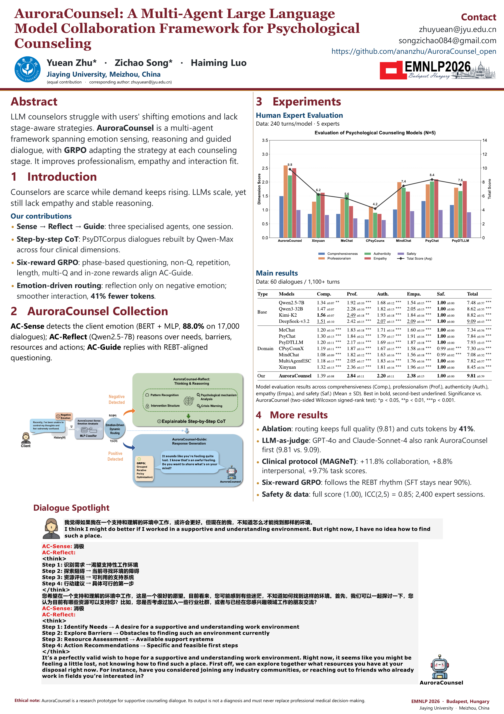
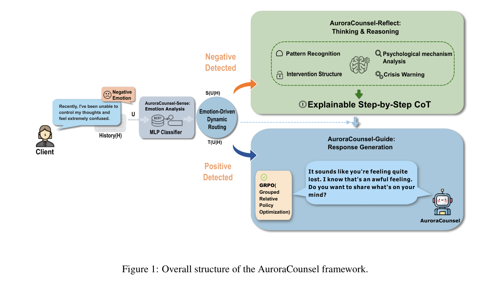

# [EMNLP 2026 Main] AuroraCounsel: A Multi-Agent Large Language Model Collaboration Framework for Psychological Counseling

<p align="center">
    <a href="./paper/AuroraCounsel_EMNLP2026.pdf"></a>
    <a href="./poster/AuroraCounsel_EMNLP2026_A0.pdf"></a>
    <a href="https://2026.emnlp.org/"></a>
    <a href="https://github.com/ananzhu/AuroraCousel_open/stargazers"></a>
</p>

<p align="center">
    
</p>

## 最近更新

- 我们的论文 **AuroraCounsel: A Multi-Agent Large Language Model Collaboration Framework for Psychological Counseling** 已被 **EMNLP 2026 主会录用**。
- 本项目仓库正式公开论文与海报，欢迎关注、引用和反馈。
- 作者：**Yuean Zhu**<sup>*</sup>、**Zichao Song**<sup>*</sup>、**Haiming Luo**；单位：**嘉应学院（Jiaying University）**。
- `*` 表示共同一作，通讯作者为 **Yuean Zhu**（`zhuyuean@jyu.edu.cn`）。

## 简介

心理健康服务需求持续增长，但专业咨询师资源仍然有限。现有大语言模型虽然在心理咨询和情感支持场景中展现出潜力，却常常难以处理复杂情绪动态，也难以稳定遵循具有理论依据的咨询过程。

针对这些问题，我们提出 **AuroraCounsel**，一个面向心理咨询的多智能体协作框架。AuroraCounsel 将咨询过程拆分为情绪感知、结构化心理反思和引导式回复生成三个阶段，并通过 **情绪驱动的动态路由** 在正向和负向情绪输入之间自适应选择推理路径。对于负向情绪输入，系统会启动结构化反思，避免不必要的计算开销；同时，我们使用 **Grouped Relative Policy Optimization（GRPO）** 优化引导智能体，使提问频率、支持策略和干预节奏更符合 REBT 等咨询理论。

与现有方法相比，AuroraCounsel 的主要特点包括：

- **Sense → Reflect → Guide：** 三个专门智能体协同完成情绪识别、心理推理和咨询回复。
- **Step-by-step CoT：** 基于 PsyDTCorpus，由专家参与设计提示，重构具有专业认知逻辑的推理链。
- **Six-reward GRPO：** 通过阶段提问率、非提问、重复、长度、多问题区间和区间内稳定性六类奖励，对齐咨询对话节奏。
- **Emotion-driven routing：** 仅在检测到负向情绪时触发反思推理，在保持质量的同时减少约 **41% token 消耗**。

## 论文与海报

| 资源 | 链接 |
|:---|:---|
| arXiv / ACL Anthology | 待正式页面发布后更新 |
| 论文 PDF | [AuroraCounsel_EMNLP2026.pdf](./paper/AuroraCounsel_EMNLP2026.pdf) |
| 海报 PDF | [AuroraCounsel_EMNLP2026_A0.pdf](./poster/AuroraCounsel_EMNLP2026_A0.pdf) |
| GitHub | [ananzhu/AuroraCousel_open](https://github.com/ananzhu/AuroraCousel_open) |
| Huggingface | [sunear/AuroraCousel](https://huggingface.co/sunear/AuroraCounsel) |

## 方法

<p align="center">
    
</p>

AuroraCounsel 由三个核心模块组成：

| 模块 | 角色 | 主要实现 |
|:---|:---|:---|
| **AC-Sense** | 感知单元 | 基于 `BERT-Base-Chinese` 与 `MLP` 的情绪分类器，对来访者输入进行正向 / 负向情绪判断。 |
| **AC-Reflect** | 认知核心 | 基于 `Qwen2.5-7B-Instruct`，在负向情绪触发后生成结构化推理链。 |
| **AC-Guide** | 执行单元 | 基于 `Qwen2.5-7B-Instruct`，结合对话历史和推理链生成咨询回复，并通过 SFT + GRPO 对齐专业咨询节奏。 |

### 1. 情绪驱动的动态路由

系统首先使用 `AC-Sense` 判断当前用户话语的情绪极性：

- **正向情绪：** 跳过反思模块，直接由 `AC-Guide` 生成支持性回复。
- **负向情绪：** 激活 `AC-Reflect`，生成结构化心理推理链，再交由 `AC-Guide` 生成回复。

这种路由机制能够在需要时保留显式心理推理，同时避免每一轮都执行额外推理，从而兼顾专业性与推理成本。

### 2. 结构化反思链

`AC-Reflect` 与心理学专家协作构建角色扮演提示，并基于 `PsyDTCorpus` 重构推理数据。推理链覆盖四个专业维度：

- **Pattern Recognition：** 识别主导情绪、潜在情绪及其长期认知或关系模式。
- **Psychological Mechanism Analysis：** 追溯依恋、不安全感和家庭系统等深层心理机制。
- **Intervention Structure：** 形成认知重构、资源激活等可执行的干预框架。
- **Crisis Warning：** 识别自伤或伤害风险，并触发安全评估和专业转介协议。

### 3. 六维奖励驱动的 GRPO 对齐

仅使用监督微调容易导致过度提问、单轮多问或重复追问，难以形成专业咨询的阶段性节奏。为此，AuroraCounsel 使用 GRPO 优化 `AC-Guide`，奖励函数包含：

1. **Phase-based Question Rate Reward：** 前 8 轮目标提问率为 `[0.70, 1.00]`，第 9–16 轮为 `[0.40, 0.70]`，之后为 `[0.00, 0.40]`。
2. **Non-question Reward：** 鼓励后期从追问转向解释、建议和情感支持。
3. **Repetition Penalty：** 基于 2-gram Jaccard 相似度抑制重复回复。
4. **Length Reward：** 将回复长度约束在 `[35, 65]` token，最优长度设为 `50`。
5. **Multi-question Penalty：** 当单轮问题数超过两个时施加渐进惩罚。
6. **In-zone Reward：** 鼓励提问率稳定在目标区间中心，减少对话节奏波动。

## 数据与实验设置

| 数据 / 设置 | 规模与说明 |
|:---|:---|
| AC-Sense 情绪数据 | NLPCC 2014 语料与 7,000+ 条人工标注心理咨询对话融合；16,000 条训练、1,000 条测试。 |
| AC-Reflect 推理数据 | 由心理学专家参与设计提示，基于 PsyDTCorpus 重构 2,400 个会话、44,000 轮对话。 |
| AC-Guide 训练数据 | PsyDTCorpus。SFT 后继续使用 GRPO 进行行为对齐。 |
| 自动评估集 | 60 个对话、1,100+ 轮，覆盖 PsyDTCorpus 的 12 个主题领域。 |
| 人工评估 | 5 位具有临床咨询认证的高校心理学教授，每个模型评估 240 轮。 |
| 基座模型 | `Qwen2.5-7B-Instruct`。 |
| 对比模型 | Qwen2.5-7B、Qwen3-32B、Kimi-K2、DeepSeek-v3.2、MeChat、PsyChat、PsyDTLLM、CPsyCounX、MindChat、MultiAgentESC、Xinyuan 等。 |

## 实验结果

### 人工专家评估

在 5 位心理学教授参与的盲评中，AuroraCounsel 在专业性、真实性和共情三个维度取得最高分，总分为 **9.81 ± 0.39**，高于最强基线 DeepSeek-v3.2 的 **9.09 ± 0.43**。

| 模型 | Comprehensiveness | Professionalism | Authenticity | Empathy | Safety | Total |
|:---|:---:|:---:|:---:|:---:|:---:|:---:|
| DeepSeek-v3.2 | 1.51 ± 0.10 | 2.42 ± 0.15 | 2.07 ± 0.13 | 2.09 ± 0.16 | 1.00 ± 0.00 | 9.09 ± 0.43 |
| Xinyuan | 1.32 ± 0.13 | 2.36 ± 0.17 | 1.81 ± 0.16 | 1.96 ± 0.15 | 1.00 ± 0.00 | 8.45 ± 0.54 |
| **AuroraCounsel** | **1.39 ± 0.08** | **2.84 ± 0.11** | **2.20 ± 0.11** | **2.38 ± 0.13** | **1.00 ± 0.00** | **9.81 ± 0.39** |

人工评估的评分者一致性为 **ICC(2,5) = 0.85**，自动评估与专家评分之间的 Pearson 相关系数为 **0.67**。

### 动态路由与消融

| 设置 | Total | Token |
|:---|:---:|:---:|
| AuroraCounsel（完整框架） | **9.81 ± 0.39** | **1,953 ± 99** |
| w/o AC-Sense（始终触发反思） | 9.79 ± 0.24 | 3,319 ± 152 |
| Only AC-Guide (GRPO) | 9.25 ± 0.44 | 1,169 ± 85 |
| Only AC-Guide (SFT) | 8.26 ± 0.45 | 648 ± 43 |

动态路由在几乎不损失总分的情况下，将 token 消耗从 `3,319` 降至 `1,953`，约减少 **41%**；反之，关闭路由会使计算成本增加约 70%。

### MAGneT 协议评估

在 MAGneT 评估协议下，AuroraCounsel 取得最佳整体表现，其中：

- CTRS Collaboration：**+11.8%**
- CTRS Interpersonal：**+8.8%**
- WAI Task：**+9.7%**
- PANAS 正向情绪变化：**+3.0%**

### AC-Sense 情绪识别

在 1,000 条留出测试样本上，`AC-Sense` 的性能为：

| Accuracy | Precision | Recall | F1 |
|:---:|:---:|:---:|:---:|
| **88.00%** | **88.10%** | **88.00%** | **87.99%** |

## 安全与使用边界

AuroraCounsel 是面向科研的心理咨询对话原型。尽管系统通过 `AC-Reflect`、危机预警和人工评估机制提升安全性，模型输出 **不能用于医学诊断，也不能替代专业医疗决策或临床干预**。在真实应用前，需要引入专业监管、隐私保护、风险筛查和紧急转介机制。

## 引用

如果本项目对您的研究有帮助，请引用：

```bibtex
@inproceedings{
anonymous2026auroracounsel,
title={AuroraCounsel: A Multi-Agent Large Language Model Collaboration Framework for Psychological Counseling},
author={Yuean Zhu、Zichao Song、Haiming Luo},
booktitle={The 2026 Conference on Empirical Methods in Natural Language Processing},
year={2026},
url={https://openreview.net/forum?id=hvHVxd6yvS}
}
```

## 联系方式

- Yuean Zhu: `zhuyuean@jyu.edu.cn`
- Zichao Song: `songzichao084@gmail.com`
